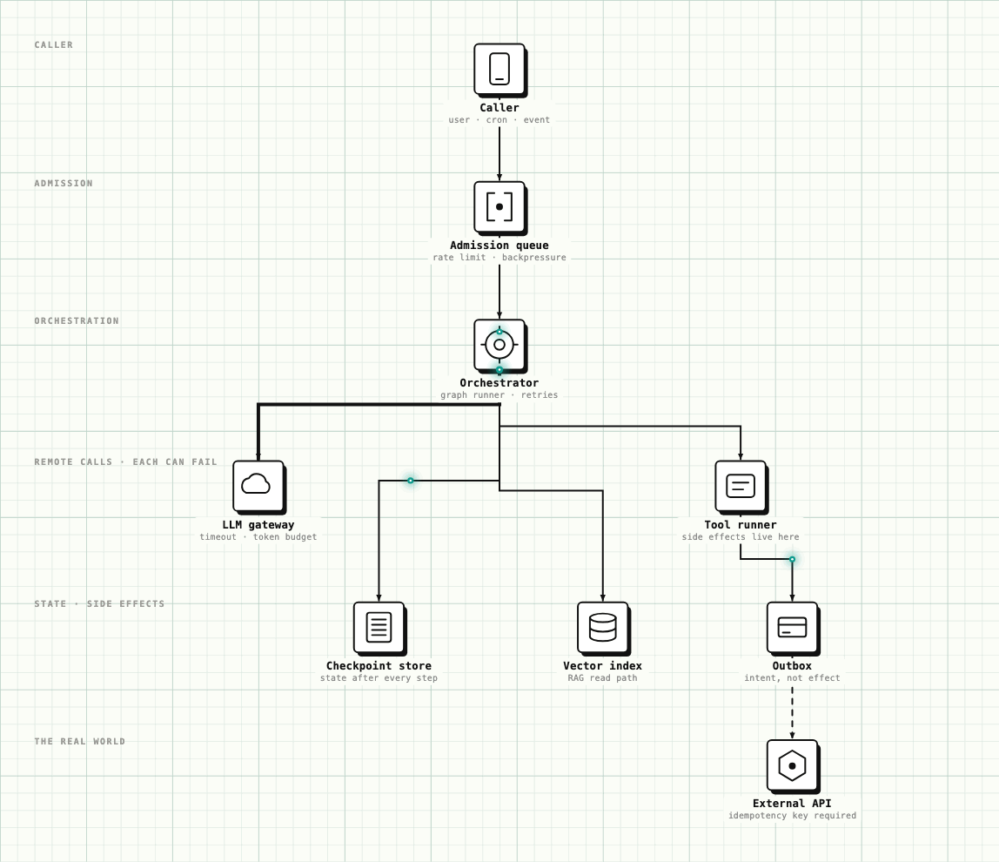

# Your agent pipeline is a distributed system. Most teams build it like a script.

The most dangerous thing about modern agent frameworks is how local they feel. You write a graph in one file, it runs in one process, the trace renders in one neat timeline. Every `await` looks like a function call.

Every one of those awaits is a network call to a machine you do not control. The LLM lives in someone else's datacenter. Every tool call crosses into some SaaS vendor's API. Your "script" is a distributed system spanning three or more administrative domains, and it has all the failure modes that implies. The frameworks did not remove those failure modes. They removed the *visual reminder* of them.

Nobody would write a payment service that calls three external APIs with no timeouts, no idempotency keys, and no queue in front of it. That is the median agent pipeline in production today.

Here is the same pipeline, drawn as what it actually is:

The rest of this article walks that diagram, one pattern at a time.

## Retries are a write amplifier

Start with the asymmetry that matters most. Retrying an LLM call is safe: it has no side effects, so a retry costs you only money and latency. Retrying a tool call is not, because tools are where side effects live.

When a tool call times out, you do not know whether it failed. The request may have created the invoice, booked the meeting, sent the email, and died on the way back. This is the uncertainty at the heart of the two generals problem, and it is older than every agent framework by decades. The framework's default answer, retry the step, is precisely the wrong answer: it turns one logical action into an unknown number of real-world ones. A retry loop around a side effect is a write amplifier pointed at your customers.

The discipline transfer is direct:

- Every tool invocation carries an idempotency key, derived deterministically from the task and step identity so a retry presents the same key. A key minted fresh per attempt deduplicates nothing.
- Side effects never leave the tool runner synchronously. The tool writes *intent* to an outbox; a relay delivers it to the external API with at-least-once semantics and deduplication at the boundary. That is the dashed line at the bottom right of the diagram, and it is the highest-leverage change you can make to an agent pipeline.

Once effects flow through an outbox, the orchestrator can retry anything, crash anywhere, and replay freely. Execution becomes cheap because effects become effectively exactly-once: delivered at least once, applied once because the boundary deduplicates. Where a downstream API offers no way to deduplicate, that step cannot ride the outbox, and it needs a human in front of it.

## Backpressure, or the rate-limit cascade

A planner fans out to twenty sub-agents. Each makes five LLM calls. A burst of user traffic multiplies that by fifty. Your provider answers with 429s, every branch backs off on the same schedule, and they all come back at the same instant, a synchronized retry storm. The pipeline did not degrade, it collapsed, and it collapsed in the middle where you cannot shed load gracefully.

Jitter de-synchronizes the herd, but it only spreads the demand out; it does not reduce it. The real answer is older: admission control belongs at the edge. That is the queue at the top of the diagram. Demand that exceeds capacity gets queued or shed *before* work starts, not discovered mid-task when half the fan-out has already executed.

And in an LLM system, capacity has a precise unit: tokens per minute is a rate limit, token budget per task is a quota, and both are capacity planning problems. If you cannot say what one task is allowed to spend, you have not sized your system, you have just deployed it.

## Context is state you never compact

Conversation history is an append-only log, and most pipelines run it with no compaction policy. Any storage engineer can tell you how that story ends: reads get slower, cost grows linearly with history, and eventually you hit the hard limit, because a context window is just a disk that fills.

The fix is the same as it is in a storage engine, compaction with invariants. Decide what must survive verbatim: the task specification, hard constraints, open commitments. Everything else (tool outputs, intermediate reasoning, retrieved passages) gets summarized or dropped on a policy, not when someone notices the bill. The retrieval path exists so evidence can live outside the log and be re-read on demand instead of carried forever.

## A timeout, an error, and a confident lie are three different failures

Classical systems mostly fail in two ways: a process stops, or a message goes missing. Both are visible as absence, and both are what retries, timeouts, and health checks were built for.

Agent systems add a third class as a routine occurrence: the component returns on time, well-formed, and wrong, with full confidence. In the distributed systems literature that is Byzantine behavior (arbitrary faults, no malice required), and the literature is blunt about it: you cannot detect it from the shape of the response. Agent pipelines are the first mainstream systems built around a component that produces this failure class at a routine rate while operating exactly as designed.

The operational consequence: a retry fixes an omission, it does not fix a lie. Asking the same model the same question again and hoping is not a strategy. What works is what always worked against Byzantine components:

- Independent verification: validators that check outputs against ground truth, schemas, invariants, or the source documents.
- Redundancy with voting, with the classical caveat intact: voting only works when failures are independent, so diversify across models, prompts, or methods. N samples from one model mostly measure its consistency, not its correctness.
- A human gate where the blast radius justifies it.

Verification is expensive, so spend it where distributed systems spend redundancy: on the steps with irreversible side effects, not uniformly across every token.

## Checkpoint like a database, compensate like a saga

A real agent task runs for minutes or hours. In that window your process will be redeployed, your pod rescheduled, your provider will have an incident. A pipeline that holds its state in process memory treats a routine deploy as data loss.

So the orchestrator in the diagram writes state to a checkpoint store after every step. The agent stops being a long-lived process and becomes what it should have been from the start: a resumable state machine, where any crash is a restart from the last completed step.

Checkpoints solve crashes. They do not solve the uglier case: step seven fails permanently after steps one through six already changed the world. There are no distributed transactions across SaaS vendors, no two-phase commit with Stripe and Salesforce at once. The pattern that remains is the saga: every side-effecting step ships with its compensating action, and the orchestrator runs the compensations backward when the task dies past the point of no return. If a step has no compensation and no idempotent retry, that step needs the human gate.

## The transfer table

| Distributed systems discipline | In the agent pipeline |
| --- | --- |
| Idempotency keys | On every tool invocation |
| Outbox pattern | Side effects written as intent, delivered async |
| Admission control and backpressure | Queue at the edge, token budgets per task |
| Log compaction | Context management with invariants |
| Checkpoint and restore | Resumable task state after every step |
| Sagas | Compensating actions for multi-step side effects |
| Redundancy and voting | Diverse verification on high-stakes outputs |

None of this is new. That is the point. The hard problems in production agent systems are not prompt problems; they are the problems this field already solved once, wearing a new costume. Teams that miss the costume are rediscovering the two generals problem, one duplicated invoice at a time.
